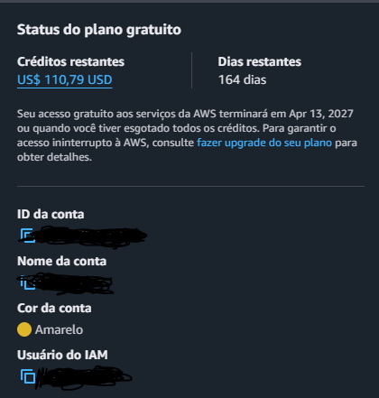
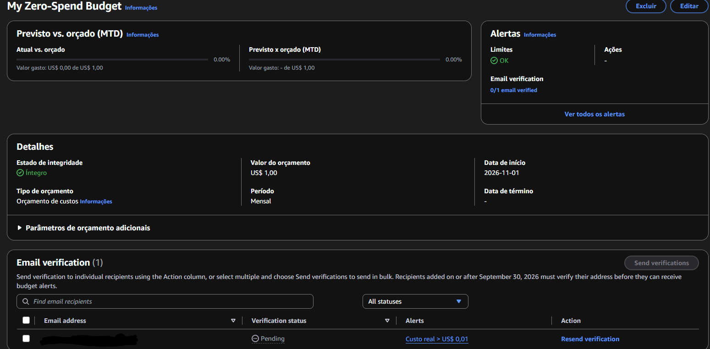

# AWS Lab 00 — Conta Segura

## Objetivo

Este laboratório tem como objetivo aplicar boas práticas de segurança e controle de custos em uma conta AWS, utilizando autenticação multifator (MFA) e monitoramento de orçamento.

## Configurações realizadas

| Configuração | Do que ela protege | Domínio da prova |

| MFA ativado | Reduz o risco de acesso não autorizado à conta AWS. | Segurança

| AWS Budgets configurado | Permite acompanhar os gastos e identificar possíveis custos inesperados. | Cobrança

| Alerta de orçamento | Notifica quando os gastos atingem o limite definido. | Cobrança

## Checklist

- [x] Configuração de MFA
- [x] Criação de orçamento AWS
- [x] Configuração de alerta de orçamento
- [x] Registro das evidências
- [x] Documentação das configurações

## Evidências

### MFA ativo

### AWS Budget

## O que aprendi

Neste laboratório, aprendi a aplicar medidas básicas de segurança em uma conta AWS, utilizando MFA para reforçar a autenticação e AWS Budgets para acompanhar os custos.
Também compreendi a importância de prevenir acessos indevidos e monitorar os gastos desde o início da utilização da nuvem.

## Tecnologias e serviços

- AWS IAM
- AWS Billing and Cost Management
- AWS Budgets
- GitHub
- Markdown
